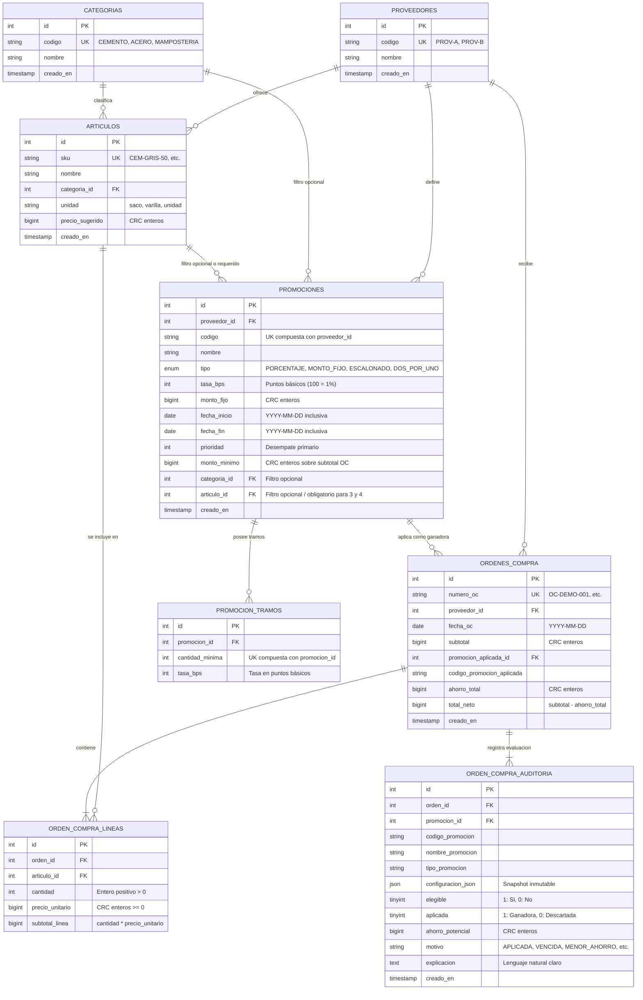

# Diagrama Entidad-Relación — ObraNeta
**Constructora Del Valle S.A.** · Gestión de Inventarios (Quiz #2, Parte B, Opción 3)

Este diagrama representa el modelo relacional implementado en MySQL 8.4 (InnoDB, utf8mb4) y SQLite, con integridad referencial, claves foráneas estrictas y tipos de datos normalizados.

