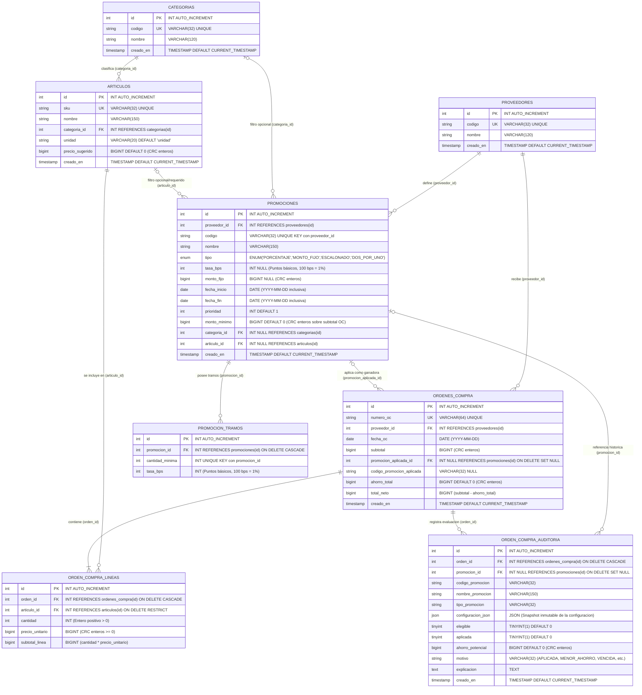

# Diagrama Entidad-Relación y Especificación del Modelo — ObraNeta
**Constructora Del Valle S.A.** · Gestión de Inventarios (Quiz #2, Parte B, Opción 3)

Este documento contiene la representación visual y el diccionario de datos del modelo relacional implementado en **MySQL 8.4** (InnoDB, utf8mb4) y **SQLite**, garantizando integridad referencial, claves foráneas estrictas, inmutabilidad de auditoría y precisión monetaria en colones costarricenses (CRC).

---

## 1. Diagrama Entidad-Relación (Mermaid)

---

## 2. Diccionario de Datos

### Tabla: `proveedores`
Almacena las empresas proveedoras de materiales para Constructora Del Valle S.A.

| Campo | Tipo SQL | Nulo | Clave | Descripción |
| :--- | :--- | :---: | :---: | :--- |
| `id` | `INT AUTO_INCREMENT` | No | PK | Identificador interno único del proveedor. |
| `codigo` | `VARCHAR(32)` | No | UK | Código alfanumérico único de identificación (ej. `PROV-A`). |
| `nombre` | `VARCHAR(120)` | No | — | Razón social o nombre comercial del proveedor. |
| `creado_en` | `TIMESTAMP` | No | — | Marca de tiempo automática de registro. |

---

### Tabla: `categorias`
Clasificación de artículos del catálogo (cemento, aceros, mampostería, etc.).

| Campo | Tipo SQL | Nulo | Clave | Descripción |
| :--- | :--- | :---: | :---: | :--- |
| `id` | `INT AUTO_INCREMENT` | No | PK | Identificador interno de la categoría. |
| `codigo` | `VARCHAR(32)` | No | UK | Código alfabético único (ej. `CEMENTO`, `ACERO`). |
| `nombre` | `VARCHAR(120)` | No | — | Nombre descriptivo de la categoría. |
| `creado_en` | `TIMESTAMP` | No | — | Marca de tiempo automática de registro. |

---

### Tabla: `articulos`
Catálogo de materiales y productos disponibles para emitir órdenes de compra.

| Campo | Tipo SQL | Nulo | Clave | Descripción |
| :--- | :--- | :---: | :---: | :--- |
| `id` | `INT AUTO_INCREMENT` | No | PK | Identificador único del artículo. |
| `sku` | `VARCHAR(32)` | No | UK | Código SKU único del material (ej. `CEM-GRIS-50`). |
| `nombre` | `VARCHAR(150)` | No | — | Descripción comercial del artículo. |
| `categoria_id` | `INT` | No | FK | Referencia a `categorias(id)`. |
| `unidad` | `VARCHAR(20)` | No | — | Unidad de medida (ej. `saco`, `varilla`, `unidad`, `kg`, `m³`). |
| `precio_sugerido` | `BIGINT` | No | — | Precio unitario base en colones enteros (CRC). |
| `creado_en` | `TIMESTAMP` | No | — | Marca de tiempo automática de registro. |

---

### Tabla: `promociones`
Reglas comerciales configuradas por cada proveedor. Soporta los 4 tipos de beneficio.

| Campo | Tipo SQL | Nulo | Clave | Descripción |
| :--- | :--- | :---: | :---: | :--- |
| `id` | `INT AUTO_INCREMENT` | No | PK | Identificador interno de la regla de promoción. |
| `proveedor_id` | `INT` | No | FK | Proveedor dueño de la promoción (`proveedores(id)`). |
| `codigo` | `VARCHAR(32)` | No | UK* | Código único por proveedor (ej. `CEMENTO5`). |
| `nombre` | `VARCHAR(150)` | No | — | Nombre comercial de la promoción. |
| `tipo` | `ENUM` | No | — | Uno de: `PORCENTAJE`, `MONTO_FIJO`, `ESCALONADO`, `DOS_POR_UNO`. |
| `tasa_bps` | `INT` | Sí | — | Tasa en puntos básicos (100 bps = 1 %). Para `PORCENTAJE`. |
| `monto_fijo` | `BIGINT` | Sí | — | Descuento directo en colones enteros. Para `MONTO_FIJO`. |
| `fecha_inicio` | `DATE` | No | — | Fecha inicial de vigencia (inclusiva, `YYYY-MM-DD`). |
| `fecha_fin` | `DATE` | No | — | Fecha final de vigencia (inclusiva, `YYYY-MM-DD`). |
| `prioridad` | `INT` | No | — | Entero para desempates cuando el ahorro es idéntico. |
| `monto_minimo` | `BIGINT` | No | — | Subtotal mínimo de OC requerido en CRC (0 si no aplica). |
| `categoria_id` | `INT` | Sí | FK | Filtro opcional por categoría (`categorias(id)`). |
| `articulo_id` | `INT` | Sí | FK | Filtro por artículo (`articulos(id)`), obligatorio en 2×1 y tramos. |
| `creado_en` | `TIMESTAMP` | No | — | Marca de tiempo automática de registro. |

*\* Nota: Clave única compuesta `uq_promo_proveedor_codigo (proveedor_id, codigo)` para permitir que proveedores diferentes puedan usar el mismo código mnemónico.*

---

### Tabla: `promocion_tramos`
Tramos de escala de volumen para promociones de tipo `ESCALONADO`.

| Campo | Tipo SQL | Nulo | Clave | Descripción |
| :--- | :--- | :---: | :---: | :--- |
| `id` | `INT AUTO_INCREMENT` | No | PK | Identificador único del tramo. |
| `promocion_id` | `INT` | No | FK | Promoción a la que pertenece (`promociones(id)`). |
| `cantidad_minima` | `INT` | No | UK* | Cantidad umbral a partir de la cual aplica la tasa. |
| `tasa_bps` | `INT` | No | — | Tasa de descuento en puntos básicos para este tramo. |

*\* Nota: Clave única compuesta `uq_tramo_promo_cant (promocion_id, cantidad_minima)` para evitar tramos duplicados en una misma regla.*

---

### Tabla: `ordenes_compra`
Registro oficial de cada orden de compra confirmada con su liquidación financiera.

| Campo | Tipo SQL | Nulo | Clave | Descripción |
| :--- | :--- | :---: | :---: | :--- |
| `id` | `INT AUTO_INCREMENT` | No | PK | Identificador interno de la OC. |
| `numero_oc` | `VARCHAR(64)` | No | UK | Número correlativo único asignado a la OC (ej. `OC-2026-001`). |
| `proveedor_id` | `INT` | No | FK | Proveedor al que se le emite la compra. |
| `fecha_oc` | `DATE` | No | — | Fecha de emisión de la orden (`YYYY-MM-DD`). |
| `subtotal` | `BIGINT` | No | — | Suma de subtotales de línea antes de descuentos (CRC). |
| `promocion_aplicada_id` | `INT` | Sí | FK | Promoción ganadora (`ON DELETE SET NULL`). |
| `codigo_promocion_aplicada` | `VARCHAR(32)` | Sí | — | Código de la promoción ganadora (`NULL` si no aplicó). |
| `ahorro_total` | `BIGINT` | No | — | Descuento total aplicado en colones enteros (CRC). |
| `total_neto` | `BIGINT` | No | — | Importe final neto a pagar (`subtotal - ahorro_total`). |
| `creado_en` | `TIMESTAMP` | No | — | Marca de tiempo automática de confirmación. |

---

### Tabla: `orden_compra_lineas`
Detalle de artículos, cantidades y precios que componen una orden de compra.

| Campo | Tipo SQL | Nulo | Clave | Descripción |
| :--- | :--- | :---: | :---: | :--- |
| `id` | `INT AUTO_INCREMENT` | No | PK | Identificador de la línea. |
| `orden_id` | `INT` | No | FK | Orden de compra contenedora (`ordenes_compra(id)`). |
| `articulo_id` | `INT` | No | FK | Material adquirido (`articulos(id)`). |
| `cantidad` | `INT` | No | — | Cantidad entera de unidades adquiridas (> 0). |
| `precio_unitario` | `BIGINT` | No | — | Precio unitario acordado en colones enteros (CRC). |
| `subtotal_linea` | `BIGINT` | No | — | Importe bruto de la línea (`cantidad * precio_unitario`). |

---

### Tabla: `orden_compra_auditoria`
Registro histórico e inmutable de **todas** las promociones evaluadas al confirmar una OC.

| Campo | Tipo SQL | Nulo | Clave | Descripción |
| :--- | :--- | :---: | :---: | :--- |
| `id` | `INT AUTO_INCREMENT` | No | PK | Identificador del registro de auditoría. |
| `orden_id` | `INT` | No | FK | Orden de compra evaluada (`ordenes_compra(id)`). |
| `promocion_id` | `INT` | Sí | FK | Referencia opcional a `promociones(id)`. |
| `codigo_promocion` | `VARCHAR(32)` | No | — | Código de la promoción evaluada. |
| `nombre_promocion` | `VARCHAR(150)` | No | — | Nombre de la promoción al momento de la orden. |
| `tipo_promocion` | `VARCHAR(32)` | No | — | Tipo de promoción evaluada. |
| `configuracion_json` | `JSON` | No | — | **Snapshot inmutable** de las condiciones evaluadas. |
| `elegible` | `TINYINT(1)` | No | — | 1 si cumplió las condiciones de fecha, mínimo y filtros; 0 si no. |
| `aplicada` | `TINYINT(1)` | No | — | 1 si fue la promoción ganadora; 0 si fue descartada. |
| `ahorro_potencial` | `BIGINT` | No | — | Descuento que habría generado de haber ganado (CRC). |
| `motivo` | `VARCHAR(32)` | No | — | Código del motivo (`APLICADA`, `MENOR_AHORRO`, `VENCIDA`, etc.). |
| `explicacion` | `TEXT` | No | — | Explicación legible del descarte o de la victoria. |
| `creado_en` | `TIMESTAMP` | No | — | Marca de tiempo del registro. |

---

## 3. Matriz de Claves Foráneas y Reglas de Integridad

| Tabla Origen | Clave Foránea | Tabla Destino | Regla ON DELETE | Justificación en el Dominio |
| :--- | :--- | :--- | :--- | :--- |
| `articulos` | `categoria_id` | `categorias(id)` | `RESTRICT` | No se puede eliminar una categoría si contiene materiales activos. |
| `promociones` | `proveedor_id` | `proveedores(id)` | `RESTRICT` | Impide borrar proveedores con reglas comerciales activas. |
| `promociones` | `categoria_id` | `categorias(id)` | `RESTRICT` | Preserva la coherencia de los filtros comerciales. |
| `promociones` | `articulo_id` | `articulos(id)` | `RESTRICT` | Evita eliminar artículos que formen parte de promociones 2×1 o tramos. |
| `promocion_tramos`| `promocion_id` | `promociones(id)` | `CASCADE` | Al eliminar o actualizar una regla escalonada, se eliminan sus tramos. |
| `ordenes_compra` | `proveedor_id` | `proveedores(id)` | `RESTRICT` | Garantiza trazabilidad contable: no se borran proveedores con OCs emitidas. |
| `ordenes_compra` | `promocion_aplicada_id` | `promociones(id)` | `SET NULL` | Si una promo es dada de baja del catálogo, la OC conserva su código histórico y auditoría intacta. |
| `orden_compra_lineas` | `orden_id` | `ordenes_compra(id)` | `CASCADE` | Las líneas son parte dependiente de la orden de compra. |
| `orden_compra_lineas` | `articulo_id` | `articulos(id)` | `RESTRICT` | Impide la eliminación de artículos que ya fueron facturados en compras. |
| `orden_compra_auditoria` | `orden_id` | `ordenes_compra(id)` | `CASCADE` | La auditoría vive ligada a su orden de compra. |
| `orden_compra_auditoria` | `promocion_id` | `promociones(id)` | `SET NULL` | Preserva el snapshot JSON inmutable incluso si la promoción se elimina del catálogo. |

---

## 4. Decisiones de Diseño Técnico Justificadas

1. **Manejo Monetario con `BIGINT` en Colones Costarricenses (CRC):**
   * En Costa Rica, el colón no maneja fracciones decimales de céntimos en operaciones comerciales reales.
   * Usar enteros previene por completo los errores de redondeo acumulativos del estándar IEEE 754 de coma flotante.
2. **Tasas de Descuento en Puntos Básicos (`tasa_bps`):**
   * Se almacenan como enteros donde $100\text{ bps} = 1\%$ (ej. $5\% = 500$, $5.25\% = 525$, $100\% = 10000$).
   * Permite admitir hasta 2 decimales sin redondear prematuramente durante el cálculo.
3. **Auditoría con Snapshot `JSON` Inmutable:**
   * Las reglas comerciales cambian con el tiempo (vigencias, mínimos, porcentajes). Al auditar una OC, se guarda una copia exacta de la configuración que se evaluó en ese instante, garantizando cumplimiento para auditorías externas o fiscales.
4. **Fechas Tipo `DATE` (`YYYY-MM-DD`):**
   * Las vigencias y órdenes son comparadas exclusivamente a nivel de fecha natural, eliminando inconsistencias por zonas horarias o desfases UTC.
